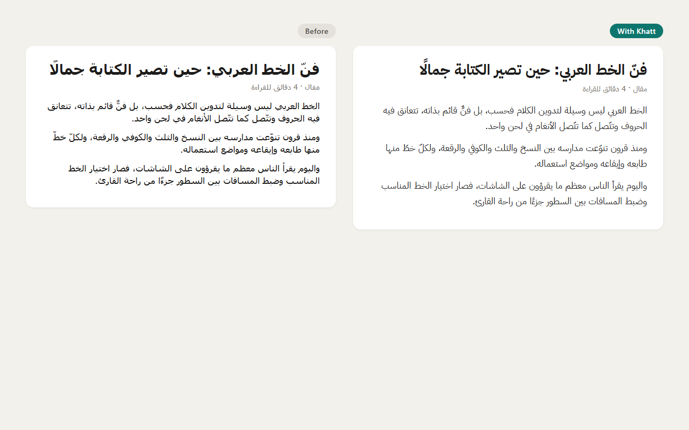

# Khatt (خط)

A Chrome extension that makes Arabic text easier to read on any website: better fonts, comfortable line spacing and correct right-to-left alignment. Everything that is not Arabic — other text, icons, page layout — is left as the site designed it.



## Features

- **Fonts** — eight bundled Arabic typefaces, or any font installed on your computer; optional separate heading font.
- **Typography** — Arabic text size, minimum line height, word spacing; letter-spacing that breaks joined letters is removed.
- **Direction** — Arabic paragraphs, lists and text fields on left-to-right pages are aligned to the right.
- **Presets** — Comfort, Compact, Naskh, Modern.
- **Per-site settings** — turn Khatt off on a site, or give a site its own font and settings.
- **Reading aids** (off by default) — hide diacritics, convert numerals, justify paragraphs.
- **Private** — no servers, no analytics, no network requests. See [PRIVACY.md](PRIVACY.md).
- Works with Persian, Urdu and other Arabic-script languages. Interface in English and Arabic.

## Install from source

Requires Node.js 20 or later.

```bash
npm install
npm run build
```

Then open `chrome://extensions`, turn on **Developer mode**, choose **Load unpacked** and select `.output/chrome-mv3`.

## Development

| Command | What it does |
|---|---|
| `npm run dev` | Starts Chrome with the extension loaded and hot reload |
| `npm run build` | Production build into `.output/chrome-mv3` |
| `npm run zip` | Build and package for the Chrome Web Store |
| `npm run compile` | Type-check |
| `npm test` | Unit tests |
| `npm run test:e2e` | Tests in a real browser with the extension loaded (first run: `npx playwright install chromium`) |
| `npm run site-check` | Visits live sites with the extension and reports what it did; pass an output folder and URLs to check your own |
| `npm run fonts` | Copies font files from npm packages into `public/fonts` |
| `npm run icons` | Regenerates the icons |
| `npm run store-assets` | Regenerates the store screenshots |

## How it works

The chosen font is declared with a Unicode range limited to the Arabic script, so it can only ever draw Arabic characters. A content script finds elements that directly contain Arabic text and marks them; the marked elements get the Arabic font placed in front of the site's own font stack, which stays as the fallback for everything else. A mutation observer keeps up with content added later.

## Project layout

```
entrypoints/
  background.ts            install/update handling, font fallback, starting in open tabs
  content/                 the page engine: scanning, styles, direction, text rewriting, font loading
  shadow-hook.content.ts   announces late-attached shadow roots (runs in the page's world)
  popup/  options/         the extension's own pages
lib/                       shared logic: settings, storage, CSS generation, fonts, presets, backup
public/                    fonts (with licences), icons, translations
scripts/                   font copying, icon and store-asset generation, live-site check
tests/                     unit tests and browser tests with fixture pages
store/                     Chrome Web Store graphics
```

[PLAN.md](PLAN.md) is the original plan; the build departed from it in places. [CHROMEWEBSTORE.md](CHROMEWEBSTORE.md) holds the store listing text and permission justifications.

## Fonts

The bundled fonts are distributed under the SIL Open Font License; each licence file is in `public/fonts/`.
